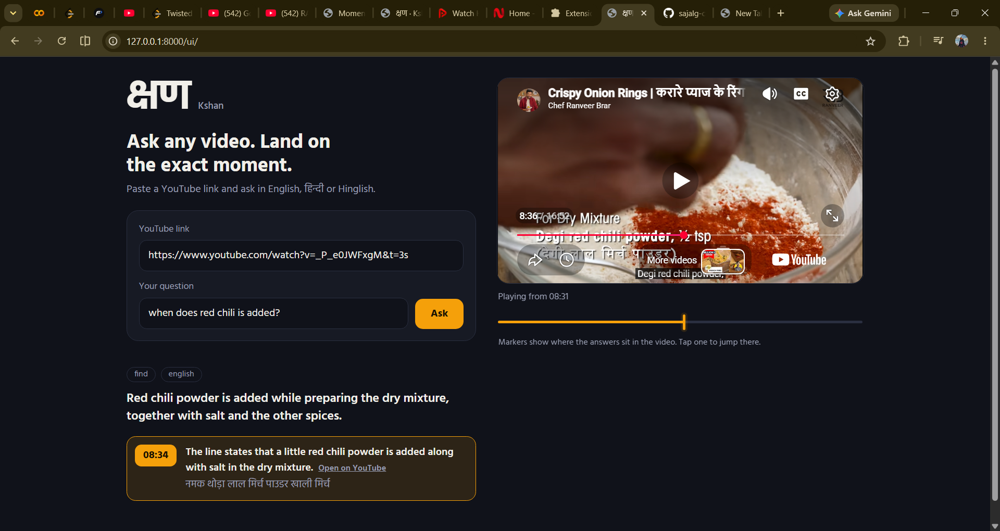

# क्षण · Kshan

**Chat with any YouTube video, and land on the exact moment.**

Paste a YouTube link and ask questions in **English, Hindi or Hinglish**. Kshan answers in the language of your question, from the video's transcript, with **clickable timestamps** that open the video at that exact second in a built-in player.



*Kshan* (क्षण) means "a moment" in Hindi.

## What you can ask

Kshan is not limited to one kind of question. A planner reads each question and picks the right strategy, so it handles anything that is answerable from what is said in the video:

| You want | Example question | What Kshan does |
| --- | --- | --- |
| **Find a moment** | "When does he add red chilli powder?" | Finds the exact lines and returns validated timestamps |
| **Check if something is mentioned** | "Did he use baking soda?" | Answers "not mentioned" with no timestamps when it is not in the video |
| **Summary of the whole video** | "Summarise this video" | Reads the whole transcript (via cached per-section notes) and writes a summary |
| **Summary of a time range** | "What happens in the first 5 minutes?", "Summarise between 5:00 and 7:00" | Restricts the answer to that part of the video |
| **Bullet points and other formats** | "Give me 5 bullet points of the key ideas" | Follows the format and length you ask for |
| **Collect every item of a kind** | "List every dip he mentions", "Which books are recommended?" | Scans every section, merges duplicates, and cites where each item appears |
| **Questions in any supported language** | "Ginger garlic paste kab daala batter mein?", "क्या उसने इसमें बेकिंग पाउडर डाला?" | Understands the question in English, Hindi or Hinglish and replies in the same language |

These are examples only. Nothing in the code is written for particular questions.

Kshan reads the **transcript**, so it answers what is *said* in the video. It cannot see what is shown on screen.

## Features

- **Any link format:** watch links, `youtu.be` share links (with `?si=`), Shorts, mobile links and bare video IDs.
- **Answers in your language,** whatever language the video is in. The caption text under each timestamp stays in the video's own language because it is the evidence, and the bold line above it is the AI's explanation in your language.
- **Honest citations:** the model returns transcript line numbers and the code turns them into real timestamps, so a time can never be invented. Weak matches carry an "uncertain" badge, and links start 3 seconds early so you hear the sentence from its beginning.
- **"Not mentioned" is a real answer:** if the video does not contain it, Kshan says so and shows no timestamp cards.
- **Videos without captions:** the audio is downloaded with yt-dlp and transcribed with Whisper on Groq.
- **Dark web UI** with an embedded YouTube player, clickable timestamp cards and a timeline with markers where the answers sit in the video.
- **Built for free-tier limits:** token pacing, retries, caching, and a backup model.

## How it works

```
link -> video ID -> captions (or Whisper) -> clean -> 40 s overlapping chunks -> bge-m3 vectors -> Qdrant
question -> planner (question type, language, keywords, time range)
   find     -> keyword scan + vector search -> LLM returns cited line IDs -> code validates -> timestamps
   overview -> sampled text, or cached per-section notes (map-reduce) -> LLM
   collect  -> extract items from every section -> merge duplicates -> validated timestamps
```

- **LangChain** handles the LLM calls (retry and fallback to a backup model), prompt templates, structured output with a strict JSON schema (the question planner), and the map-reduce chains.
- **Custom code** handles time-based chunking, line-level timestamps, citation validation, rate-limit pacing, per-video caching and language handling. LangChain's text splitters are length-based and cannot keep per-line timestamps, which is why chunking is custom.
- **The `found` flag:** for find questions, the model also says whether the answer is actually in the transcript. When it is not, the code drops every timestamp card, so a negative answer never looks like a hit.

## Tech stack

Python 3.12, FastAPI, LangChain (`langchain-groq`), Groq (`openai/gpt-oss-120b` with `openai/gpt-oss-20b` as backup, `whisper-large-v3` for speech), Qdrant Cloud, `BAAI/bge-m3` multilingual embeddings (run locally), yt-dlp, ffmpeg, and a single-file HTML/JS frontend using the YouTube IFrame Player API.

Everything runs on free tiers.

## Evaluation

`evaluate.py` runs 8 hand-labelled questions on one Hindi cooking video: English, Hindi and Hinglish questions, and two "not mentioned" cases. A find question passes when a returned timestamp is within the tolerance of the expected one (15 seconds by default, adjustable per question in `eval_set.json`). A "not mentioned" question passes when no timestamp is returned.

| Run | Result |
| --- | --- |
| Early runs | 6 of 8 and 7 of 8 |
| Latest run (after the fix below) | **8 of 8** |

What the evaluation found:

- One find question passed in one run and failed in another, so LLM output varies between runs. The model temperature is now 0 to reduce that.
- A Hindi "not mentioned" question failed in every early run. The answer sentence was right, but a low-confidence card still appeared because another line shared the word "powder". The fix was general: the explicit `found` flag described above.

**Read the number carefully.** This is a small development set, and the failures were found using the same questions. Treat 8 of 8 as "works on the cases it was built against", not as general accuracy. A fresh set of questions on new videos would be the fairer test.

## Run locally

Requirements: Python 3.12, a free [Groq](https://console.groq.com) API key, a free [Qdrant Cloud](https://cloud.qdrant.io) cluster, about 3 GB of disk for the embedding model, and [Deno](https://deno.com) (yt-dlp needs a JavaScript runtime for the Whisper fallback).

```powershell
git clone https://github.com/sajalg-cyber/kshan.git
cd kshan
python -m venv venv
.\venv\Scripts\Activate.ps1
pip install -r requirements.txt
Copy-Item .env.example .env
```

Open `.env` and fill in `GROQ_API_KEY`, `QDRANT_URL` and `QDRANT_API_KEY`. The other values have working defaults. Never commit `.env`; it is git-ignored.

Start the server:

```powershell
uvicorn app.main:app --reload --reload-dir app
```

Open http://127.0.0.1:8000/ui/ (API docs at `/docs`). The first question on a new video takes longer, because its transcript is embedded and cached.

Run the evaluation (about 4 minutes):

```powershell
python evaluate.py
```

## API

- `POST /ingest` with `{"url": "..."}` prepares a video and returns its ID, language, line and chunk counts and duration.
- `POST /ask` with `{"url": "...", "question": "..."}` returns the answer, the question type, the language, and a list of timestamps with explanations and links.
- `GET /health` is a health check.

## Project structure

```
app/
  main.py              FastAPI endpoints and the Whisper fallback hook
  youtube.py           link parsing and caption fetching
  chunking.py          cleaning and time-based chunks
  embeddings.py        bge-m3 embeddings
  store.py             Qdrant storage and search, per-video cache
  llm.py               ChatGroq with retry and a backup model
  planner.py           question planner (structured output)
  rag.py               routing and find questions
  mapreduce.py         overview and collect questions
  whisper_fallback.py  audio download and Whisper transcription
frontend/index.html    the web page
docs/screenshot.png    README image
evaluate.py, eval_set.json
```

## Known limitations

- **Auto-generated captions contain errors,** especially for Hindi and Hinglish.
- **Collect questions** can name items vaguely, list one item twice under different names, or miss the moment where an item is actually made, because the scan cannot always connect a naming line to later lines about the same thing. Lists are marked as possibly incomplete.
- **Speed on the free tier:** Groq allows about 8,000 tokens per minute per model, and Hindi uses roughly twice the tokens of English. Collect and overview questions can take around a minute on long videos. Overview notes are cached, but collect questions scan again each time.
- **Whisper fallback:** tested directly on one Hindi video. It accepts videos up to 90 minutes and depends on yt-dlp staying compatible with YouTube.
- **Small evaluation set:** see above.
- **Hosting:** YouTube often blocks `youtube-transcript-api` and yt-dlp requests from cloud servers, so this project is built to run locally. Downloading audio may conflict with YouTube's terms, so it is meant for learning and personal use.
- **Qdrant free clusters** are suspended after about a week of inactivity and must be resumed from the dashboard.

## Future improvements

Hybrid search (keyword plus vector) with a reranker, streaming answers, background ingestion with progress, spreading calls across both Groq models, tests and CI, Docker, LangGraph, and a React frontend.
